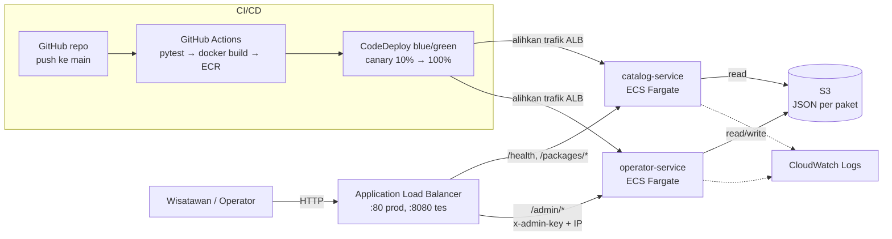

# Paket Wisata Lokal — Microservices (ECS Fargate) + CI/CD di AWS

Adaptasi lab AWS Academy **"Building Microservices and a CI/CD Pipeline with AWS"** untuk kasus
**katalog paket wisata lokal**, memakai container di ECS Fargate (ALB + S3 + CodeDeploy) dan
pipeline CI/CD dari **GitHub**.

---

## 1. Case

**Latar belakang.** Sebuah operator tur lokal menjual paket wisata (snorkeling, pendakian, tur budaya,
dll.). Selama ini daftar paket, harga, dan sisa kuota dibagikan lewat pesan dan spreadsheet. Wisatawan
sering menanyakan paket yang ternyata sudah penuh, dan data internal seperti harga modal ikut tersebar.

**Pengguna.**

| Pengguna | Kebutuhan |
| --- | --- |
| Wisatawan | Melihat paket yang sedang dijual, mencari per destinasi, mengecek sisa kuota — **hanya baca** |
| Operator tur (admin) | Menambah paket, mengubah harga dan sisa kuota, menonaktifkan atau menghapus paket |

**Kondisi awal (monolit).** Satu fungsi Lambda (`monolith/src/app.py`) menangani semua route. Masalahnya:

- siapa pun yang tahu URL bisa mengubah atau menghapus paket,
- harga modal (`costPrice`) dan catatan internal operator ikut tampil ke publik,
- paket yang sudah tidak dijual tetap muncul,
- tidak ada validasi (sisa kuota bisa lebih besar dari kuota),
- deploy manual, dan bagian publik serta admin tidak bisa di-deploy atau diskalakan terpisah.

**Solusi.** Monolit dipecah menjadi dua microservice (padanan *customer* dan *employee* di lab asli),
infrastruktur dibuat lewat skrip (boto3, karena akun lab tidak boleh CloudFormation), dan setiap `git push` otomatis dites lalu di-deploy
dengan rilis bertahap (canary blue/green).

> **Catatan lab.** Rencana awal memakai Lambda + API Gateway + DynamoDB. Akun lab tidak punya `LabRole`,
> menolak `iam:CreateRole`, dan memblokir CloudShell, sehingga arsitektur disesuaikan ke role bawaan lab:
> `PipelineRole` (ECS task: ECR, S3, Logs) dan `DeployRole` (CodeDeploy ECS). Detail di
> [`docs/PANDUAN-ECS.md`](docs/PANDUAN-ECS.md).

---

## 2. Arsitektur



| Microservice | Route | Fungsi |
| --- | --- | --- |
| `catalog-service` | `GET /health`, `GET /packages`, `GET /packages/{id}` | Read-only; hanya paket `ACTIVE`; filter `?destination=`; urut harga termurah; `costPrice` dan `operatorNotes` disembunyikan |
| `operator-service` | `GET /admin/health`, `GET` dan `POST /admin/packages`, `PUT` dan `DELETE /admin/packages/{id}` | CRUD dengan validasi; wajib header `x-admin-key`, opsional allowlist IP |

### Pemetaan ke lab asli

| Lab asli | Repo ini |
| --- | --- |
| Monolit Node.js di EC2 + RDS | `monolith/` (satu aplikasi, jalan lokal untuk analisis) |
| Cloud9 + CodeCommit | Laptop + **GitHub** |
| Docker + ECR + ECS Fargate | Sama: `services/*/Dockerfile`, repo ECR `tour-catalog`, `tour-operator` |
| ALB + rule `/admin/*` | Sama: `scripts/provision.py` |
| RDS | S3 (satu objek JSON per paket; role lab hanya punya akses S3) |
| CodeDeploy blue/green | Sama, dengan `CodeDeployDefault.ECSCanary10Percent5Minutes` |
| CodePipeline | GitHub Actions (`.github/workflows/deploy.yml`) |
| Rule IP di listener ALB | `x-admin-key` + `ALLOWED_IPS` di `operator-service` |

---

## 3. Struktur repo

```text
.
├── monolith/src/app.py          # versi awal: satu aplikasi untuk semua route (demo lokal)
├── services/
│   ├── catalog/                 # microservice publik (read-only) + Dockerfile
│   └── operator/                # microservice operator (admin) + Dockerfile
├── shared/
│   ├── store.py                 # penyimpanan paket (S3 di AWS, folder lokal untuk demo)
│   └── server.py                # adapter HTTP: request -> handler (dipakai di container)
├── infra/
│   ├── base.yaml                # stack tour-base: repo ECR + bucket S3
│   └── app.yaml                 # stack tour-app: ALB, ECS, CodeDeploy
├── tests/                       # pytest + moto (S3 tiruan)
├── .github/workflows/deploy.yml # CI/CD GitHub Actions
├── scripts/
│   ├── deploy.sh                # build image + deploy (dipanggil workflow)
│   ├── provision.py             # buat ECR, S3, ALB, ECS, CodeDeploy + rilis canary + destroy
│   ├── e2e.sh                   # tes end-to-end
│   └── monolith-demo.ps1        # demo masalah monolit (Gambar 3)
├── frontend/index.html          # halaman katalog statis (opsional)
└── docs/                        # diagram, estimasi biaya, bukti, panduan
```

## 4. Deploy

Ikuti [`docs/PANDUAN-ECS.md`](docs/PANDUAN-ECS.md). Ringkasnya: isi 4 secret GitHub (`AWS_ACCESS_KEY_ID`,
`AWS_SECRET_ACCESS_KEY`, `AWS_SESSION_TOKEN`, `ADMIN_KEY`), lalu `git push`. Workflow membuat semua
resource pada run pertama, dan pada run berikutnya merilis service yang berubah lewat canary.

## 5. Tes lokal

```bash
pip install pytest moto boto3
python -m pytest -v tests
```

