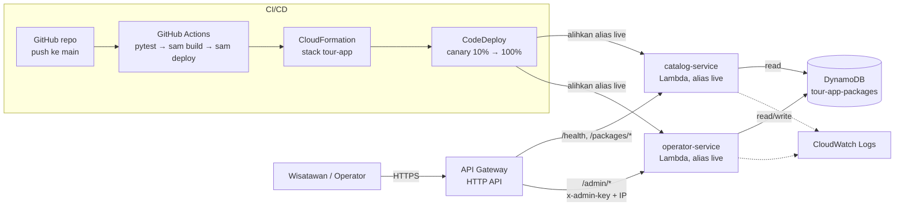

# Paket Wisata Lokal — Microservices Serverless + CI/CD di AWS

Adaptasi lab AWS Academy **"Building Microservices and a CI/CD Pipeline with AWS"** untuk kasus
**katalog paket wisata lokal**, memakai layanan serverless (API Gateway + Lambda + DynamoDB) dan
pipeline CI/CD dari **GitHub**.

---

## 1. Case

**Latar belakang.** Sebuah operator tur lokal menjual paket wisata (snorkeling, pendakian, tur budaya,
dll.). Selama ini daftar paket, harga, dan sisa kuota dibagikan lewat pesan dan spreadsheet. Wisatawan
sering menanyakan paket yang ternyata sudah penuh, dan data internal seperti harga modal ikut tersebar.

**Pengguna.**

| Pengguna | Kebutuhan |
| --- | --- |
| Wisatawan | Melihat paket yang sedang dijual, mencari per destinasi, mengecek sisa kuota — **hanya baca** |
| Operator tur (admin) | Menambah paket, mengubah harga dan sisa kuota, menonaktifkan atau menghapus paket |

**Kondisi awal (monolit).** Satu fungsi Lambda (`monolith/src/app.py`) menangani semua route. Masalahnya:

- siapa pun yang tahu URL bisa mengubah atau menghapus paket,
- harga modal (`costPrice`) dan catatan internal operator ikut tampil ke publik,
- paket yang sudah tidak dijual tetap muncul,
- tidak ada validasi (sisa kuota bisa lebih besar dari kuota),
- deploy manual, dan bagian publik serta admin tidak bisa di-deploy atau diskalakan terpisah.

**Solusi.** Monolit dipecah menjadi dua microservice (padanan *customer* dan *employee* di lab asli),
infrastruktur ditulis sebagai kode (AWS SAM), dan setiap `git push` otomatis dites lalu di-deploy dengan
rilis bertahap (canary).

---

## 2. Arsitektur



| Microservice | Route | Fungsi |
| --- | --- | --- |
| `catalog-service` | `GET /health`, `GET /packages`, `GET /packages/{id}` | Read-only; hanya paket `ACTIVE`; filter `?destination=`; urut harga termurah; `costPrice` dan `operatorNotes` disembunyikan |
| `operator-service` | `GET /admin/health`, `GET` dan `POST /admin/packages`, `PUT` dan `DELETE /admin/packages/{id}` | CRUD dengan validasi; wajib header `x-admin-key`, opsional allowlist IP |

**Entitas `TourPackage`:**

| Field | Tipe | Keterangan |
| --- | --- | --- |
| `packageId` | String (UUID) | Partition key, dibuat otomatis |
| `name` | String | Nama paket, mis. "Snorkeling Pulau Seribu 2D1N" |
| `destination` | String | Destinasi |
| `durationDays` | Integer ≥ 1 | Lama perjalanan |
| `price` | Number ≥ 0 | Harga jual per orang (Rp) |
| `costPrice` | Number ≥ 0 | Harga modal — **internal** |
| `quota` | Integer ≥ 1 | Kuota peserta |
| `remainingQuota` | Integer 0..quota | Sisa kuota (default = quota) |
| `operatorNotes` | String | Catatan operator — **internal** |
| `status` | `ACTIVE` / `INACTIVE` | Hanya `ACTIVE` yang tampil di katalog |

### Pemetaan ke lab asli

| Lab asli | Repo ini |
| --- | --- |
| Monolit Node.js di EC2 + RDS | `monolith/` (satu Lambda) + DynamoDB |
| Cloud9 + CodeCommit | Laptop / CloudShell + **GitHub** |
| Docker + ECR + ECS Fargate | Lambda dikemas AWS SAM (`template.yaml`) |
| ALB + rule `/admin/*` | API Gateway HTTP API + route `/admin/*` |
| CodeDeploy blue/green | CodeDeploy canary untuk Lambda |
| CodePipeline | GitHub Actions (atau CodePipeline + `buildspec.yml`) |
| Rule IP di listener ALB | `x-admin-key` + `ALLOWED_IPS` di `operator-service` |

| Requirement | Bukti |
| --- | --- |
| R1 Desain | `docs/architecture.png` |
| R2 Biaya | `docs/cost-estimate.pdf` (AWS Pricing Calculator, us-east-1, 12 bulan) |
| R3 Microservices | Dua fungsi Lambda terpisah dengan route masing-masing |
| R4 Portability | Tes lokal `pytest` (+ `sam local` dengan Docker) |
| R5 Scalability | Lambda + DynamoDB On-demand auto-scale, canary + rollback |
| R6 CI/CD otomatis | Push ke `main` → GitHub Actions → deploy |

---

## 3. Struktur repo

```text
.
├── monolith/
│   ├── template.yaml            # stack tour-monolith (Fase 2)
│   └── src/app.py               # versi awal: satu Lambda untuk semua route
├── services/
│   ├── catalog/app.py           # microservice publik (read-only)
│   └── operator/app.py          # microservice operator (admin)
├── tests/                       # pytest + moto (DynamoDB tiruan)
├── template.yaml                # infrastruktur microservices (stack tour-app)
├── .github/workflows/deploy.yml # CI/CD GitHub Actions
├── buildspec.yml                # alternatif: CodeBuild/CodePipeline
├── scripts/
│   ├── deploy-monolith.sh       # deploy monolit
│   ├── deploy.sh                # deploy microservices
│   └── e2e.sh                   # tes end-to-end
├── frontend/index.html          # halaman katalog statis (opsional)
└── docs/                        # diagram, estimasi biaya, bukti
```

---

## 4. Panduan deploy ke AWS

### Langkah 0 — Prasyarat

- Akun GitHub.
- Lab AWS aktif: di Canvas klik **Start Lab**, tunggu titik hijau, klik **AWS**. Region **us-east-1**.
- Untuk tes lokal (opsional): Python 3.12, `pip install pytest moto boto3`.

### Langkah 1 — Cek role IAM (sekali saja)

Lab AWS Academy tidak mengizinkan membuat role baru, jadi kita memakai role yang sudah ada.

1. Console → **IAM → Roles**. Catat role yang tersedia (misalnya `LabRole`, `PipelineRole`, `DeployRole`).
2. Console → **Lambda → Create function** → *Use an existing role*. Role yang muncul di dropdown adalah
   role yang bisa dipakai Lambda. Batalkan setelah mencatatnya.
3. Salin **ARN** role tersebut dari IAM (contoh: `arn:aws:iam::123456789012:role/LabRole`) sebagai
   `LAB_ROLE_ARN`.
4. Kalau ada `DeployRole`, salin juga ARN-nya sebagai `DEPLOY_ROLE_ARN`.

> Kalau dropdown Lambda kosong, tidak ada role untuk Lambda dan jalur serverless tidak bisa dipakai di
> akun ini. Konsultasikan ke dosen/asisten sebelum lanjut.

### Langkah 2 — Push repo ke GitHub

```bash
git init
git checkout -b main
git add monolith .gitignore README.md
git commit -m "chore: add tour package monolith (before microservices)"
git add .
git commit -m "feat: split monolith into catalog and operator services with SAM and CI/CD"
git remote add origin https://github.com/<username>/tour-microservices.git
git push -u origin main
```

Push pertama menjalankan GitHub Actions: job `test` hijau, job `deploy` gagal karena secrets belum
diisi. Itu normal.

### Langkah 3 — Deploy dan analisis monolit (Fase 2)

Buka **CloudShell** di console AWS:

```bash
git clone https://github.com/<username>/tour-microservices.git
cd tour-microservices
export LAB_ROLE_ARN=arn:aws:iam::<ACCOUNT_ID>:role/<ROLE_LAMBDA>
./scripts/deploy-monolith.sh          # mencetak URL monolit
```

Coba buktikan masalahnya:

```bash
M=<URL monolit>
curl -s -X POST $M/packages -H "Content-Type: application/json" \
  -d '{"name":"Tur Kawah Ijen","destination":"Banyuwangi","durationDays":1,"price":450000,"costPrice":300000,"quota":15}'
curl -s $M/packages                  # costPrice ikut tampil ke publik
# hapus tanpa izin apa pun -> 204
curl -s -o /dev/null -w "%{http_code}\n" -X DELETE $M/packages/<packageId>
```

Repo private perlu login saat `git clone` (pakai *Personal Access Token* sebagai password), atau upload
zip lewat **Actions → Upload file** di CloudShell.

### Langkah 4 — Deploy microservices

Masih di CloudShell:

```bash
export DEPLOY_ROLE_ARN=arn:aws:iam::<ACCOUNT_ID>:role/DeployRole   # lewati kalau tidak ada
export ADMIN_KEY=<kunci-huruf-dan-angka>

SKIP_BUILD=1 ./scripts/deploy.sh      # mencetak ApiUrl
```

`SKIP_BUILD=1` dipakai karena CloudShell mungkin tidak punya Python 3.12; kodenya tanpa dependensi
tambahan sehingga aman di-deploy tanpa `sam build`. Deploy pertama ±3–5 menit.

Cek di console (dan screenshot): **CloudFormation** stack `tour-app` = `CREATE_COMPLETE`; **Lambda**
`tour-app-catalog` dan `tour-app-operator` dengan alias `live`; **API Gateway** dengan 8 route;
**DynamoDB** tabel `tour-app-packages`; **CodeDeploy** application dengan dua deployment group.

### Langkah 5 — Tes end-to-end

```bash
./scripts/e2e.sh <ApiUrl> $ADMIN_KEY | tee docs/evidence/e2e.txt
```

| Cek | Hasil benar |
| --- | --- |
| Operator tanpa key | `403` |
| Operator buat paket | `201`, data lengkap termasuk `costPrice` |
| Katalog list / detail / filter destinasi | `200`, **tanpa** `costPrice` dan `operatorNotes` |
| Operator ubah sisa kuota | `200` |
| Sisa kuota > kuota | `400` |
| Paket dinonaktifkan → detail di katalog | `404` |
| Operator hapus paket | `204` |

### Langkah 6 — Aktifkan CI/CD (GitHub Actions)

GitHub → repo → **Settings → Secrets and variables → Actions**.

| Jenis | Nama | Isi |
| --- | --- | --- |
| Secret | `AWS_ACCESS_KEY_ID` | Canvas → **AWS Details** → *AWS CLI: Show* |
| Secret | `AWS_SECRET_ACCESS_KEY` | idem |
| Secret | `AWS_SESSION_TOKEN` | idem |
| Secret | `LAB_ROLE_ARN` | ARN role Lambda dari Langkah 1 |
| Secret | `DEPLOY_ROLE_ARN` | ARN `DeployRole` (opsional) |
| Secret | `ADMIN_KEY` | Sama dengan Langkah 4 |
| Variable | `ALLOWED_IPS` | Opsional: IP yang boleh mengakses `/admin` |
| Variable | `ENABLE_CANARY` | Opsional: `false` kalau CodeDeploy bermasalah |

> **Penting:** tiga secret `AWS_*` kedaluwarsa setiap sesi lab berakhir. Setiap kali **Start Lab**,
> salin ulang dari *AWS Details* sebelum push.

Buka tab **Actions** → *test-and-deploy* → **Run workflow**. Kedua job harus hijau.

### Langkah 7 — Ubah kode, buktikan pipeline + canary (Fase 9 lab)

Tambahkan label ketersediaan di `services/catalog/app.py`:

```python
VERSION = "1.1"                          # dari 1.0


def availability(item):
    remaining, quota = item.get("remainingQuota", 0), item.get("quota", 0)
    if remaining <= 0:
        return "PENUH"
    if remaining <= quota * Decimal("0.2"):
        return "HAMPIR PENUH"
    return "TERSEDIA"


def public_view(item):
    view = {k: item[k] for k in PUBLIC_FIELDS if k in item}
    view["availability"] = availability(item)
    return view
```

```bash
git commit -am "feat(catalog): add availability label, bump to 1.1"
git push
```

- **GitHub → Actions**: workflow jalan otomatis (R6).
- **CodeDeploy → Deployments**: deployment catalog dengan trafik 10%/90% selama 5 menit. Operator tidak
  ikut di-deploy karena kodenya tidak berubah.
- Selama canary: `for i in $(seq 1 40); do curl -s <ApiUrl>/health; echo; done | sort | uniq -c`
  → campuran versi 1.0 dan 1.1.
- Setelah selesai, `GET /packages` menampilkan field `availability` (`TERSEDIA` / `HAMPIR PENUH` / `PENUH`).

**Bonus:** push tes yang sengaja gagal → job `test` merah, job `deploy` tidak jalan, production aman.

### Langkah 8 — Batasi akses operator dan scaling

- **Akses:** isi variable `ALLOWED_IPS` dengan IP dari `curl https://checkip.amazonaws.com`, jalankan
  ulang workflow. Request `/admin/*` dari IP lain (misalnya dari CloudShell) → `403`.
- **Scaling:** `seq 1 300 | xargs -P 25 -I{} curl -s -o /dev/null -w "%{http_code}\n" <ApiUrl>/packages | sort | uniq -c`,
  lalu **CloudWatch → Metrics → Lambda → By Function Name** → `ConcurrentExecutions`.
  Catalog naik, operator datar.

### Langkah 9 — Frontend (opsional)

Buat bucket S3 dengan *Static website hosting*, isi `API_URL` di `frontend/index.html` dengan ApiUrl,
lalu `aws s3 sync frontend/ s3://<nama-bucket>`. CORS sudah diatur di `template.yaml`.

### Langkah 10 — Cleanup (setelah tugas dinilai)

```bash
sam delete --stack-name tour-app --no-prompts
sam delete --stack-name tour-monolith --no-prompts
```

Lalu hapus stack `aws-sam-cli-managed-default` di CloudFormation (kosongkan dulu bucket S3-nya), dan
klik **End Lab**.

---

## 5. Troubleshooting

| Gejala | Solusi |
| --- | --- |
| `not authorized to perform iam:CreateRole` | Pastikan `LAB_ROLE_ARN` terisi; template tidak membuat role baru |
| CodeDeploy gagal / `AccessDenied` saat deploy | Set `ENABLE_CANARY=false` (atau isi `DEPLOY_ROLE_ARN` dengan `DeployRole`) |
| `ExpiredToken` di GitHub Actions | Perbarui 3 secret `AWS_*` dari *AWS Details* |
| Stack `ROLLBACK_COMPLETE` | Lihat tab *Events* untuk error pertama → `sam delete` → perbaiki → deploy ulang |
| `sam build` gagal: Python 3.12 tidak ditemukan | Jalankan deploy dengan `SKIP_BUILD=1` |
| `sam: command not found` | `pip3 install --user aws-sam-cli`, lalu buka ulang terminal |
| `403 Akses operator ditolak` padahal key benar | Cek `ALLOWED_IPS`; kosongkan kalau tidak dipakai |

## 6. Tes lokal

```bash
pip install pytest moto boto3
python -m pytest -q tests
```
